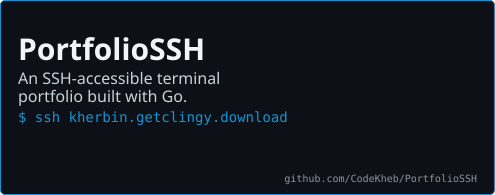
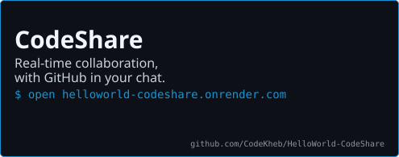
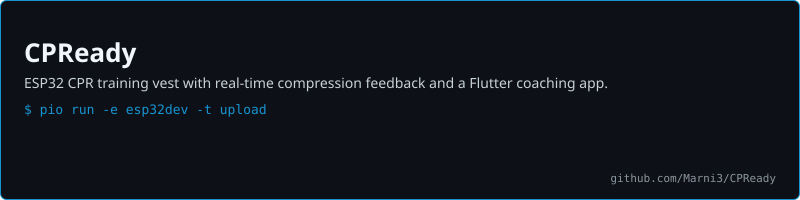
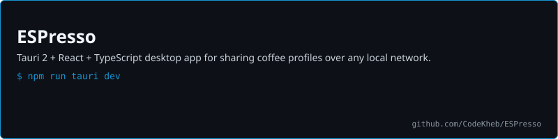
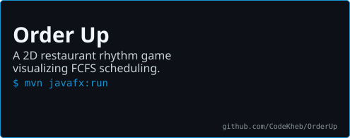
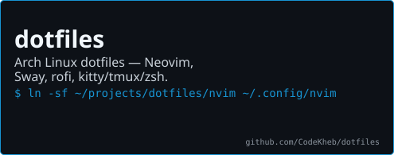

# `$ whoami`

## `$ ls ~/projects `

         

 

        

 

         

 

         

 

      

 

     

 

        

---

## `$ git log --graph --oneline`

<picture>
  <source media="(prefers-color-scheme: dark)" srcset="https://raw.githubusercontent.com/CodeKheb/CodeKheb/output/github-contribution-grid-snake-dark.svg" />
  <source media="(prefers-color-scheme: light)" srcset="https://raw.githubusercontent.com/CodeKheb/CodeKheb/output/github-contribution-grid-snake.svg" />
  
</picture>

---

## `$ curl -sL https://CodeKheb.dev/contact`

